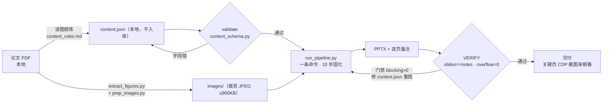

# paper-fig-deck — 文献逐图精讲 PPTX 流水线

科学论文 PDF → **逐图精讲 PPTX**：左原图 + 右大段正文（≥18pt、首行缩进 + 两端对齐）、
页底原文引用条 + 逐页演讲者备注。自学与组会汇报两用。后端 PPT 工具链**不限定**，推荐 PPT Master。

> **想先看文档？** [使用手册](docs/index.html)（单文件 HTML，可离线打开）·
> [在线阅读 ↗](https://cl4y68.github.io/paper-fig-deck/)（GitHub Pages）
> —— 含 10 步流水线、content.json 字段表、版面契约、校验器分级、排错手册。

## Quickstart（新机器 / 新 agent）

```bash
git clone <本仓库> && cd paper-fig-deck
python -m venv .venv
.venv\Scripts\pip install -r requirements.txt      # Linux/macOS: .venv/bin/pip

git clone https://github.com/hugohe3/ppt-master /path/to/ppt-master
export PPTMASTER_DIR=/path/to/ppt-master           # Windows: setx PPTMASTER_DIR ...

python pipeline/doctor.py                          # 环境自检：缺什么、怎么补
python pipeline/run_pipeline.py sample --dry-run   # 不需要 ppt-master 的冒烟测试
python pipeline/run_pipeline.py sample --name demo # 完整链路：门禁 → 导出 → 校验
```

一次做多篇（可断点续跑）：

```bash
python pipeline/batch.py batch.json     # batch.json 列出各 workdir
python pipeline/batch.py batch.json     # 中断后原样重跑：已完成的跳过，只重试失败项
```

状态逐篇落盘到同目录 `batch_state.json`；`--force` 全量重建、`--retries N` 额外重试、
`--only <workdir>` 只跑指定篇。每条记录带 `content.json` 指纹：文案改过、或交付被删的那篇
会自动重建，不会被"已完成"挡住。

`sample/` 是一篇**纯合成**假论文（虚构材料、虚构数值、脚本生成的图），
用来验证整条链路而不碰任何真实文献。跑完看尾部：

```
[8/9] VERIFY slides=10 notes=10 overflow=0 native_tbl=1 media=3
```

> 换成自己的数据：把 `sample/content.json` 换到你的 workdir 即可 ——
> 每篇论文只有三步：**填 content.json → 一条命令 → 看 VERIFY**。

## 平台

**不绑定系统**：主流程是纯 Python（PyMuPDF / Pillow / lxml / python-pptx），
Windows、Linux、macOS 都能跑。CI 同时在 ubuntu-latest 与 windows-latest 上验证。

| 平台 | 主流程（5→导出→校验） | 额外能力 |
|---|---|---|
| Windows 10/11 | ✅ 实测 | `measure_*.py` 用 PowerPoint COM 重测行数上限；原生表/图重排质量最佳 |
| Linux（Ubuntu 22.04/24.04） | ✅ 实测（Python 3.12，gate `blocking=0 warnings=0`、`VERIFY 10/10/0`） | `measure_*` 不可用（没有 COM/PowerPoint）——只在改字体/盒宽后才需要重测，平时构建不需要 |
| macOS | 主流程（同 Linux） | 同上；未在本仓库 CI 覆盖 |

- `requirements.txt` 的 `pywin32` 带 `sys.platform == "win32"` 标记，Linux/macOS 上直接
  `pip install -r requirements.txt` 不会失败。
- **字体**：版面按 Times New Roman + 宋体度量，Windows 自带。Linux 上缺字体**不影响构建**
  （宽度估算用的是内嵌度量，不读本地字体），只影响放映时 PowerPoint 的字体替换 ——
  Debian/Ubuntu 可 `apt install ttf-mscorefonts-installer` 拿到 Times New Roman，宋体需自备。
- 换平台后**不要**凭感觉改行数上限：改字体/盒宽/行距才需要重跑 `measure_*`（仅 Windows）。

## 架构



| 项 | 说明 |
|---|---|
| 页面流 | 封面 → 中文摘要 → Introduction 五线（单页）→ **论证主线总览**（有 `paper.mainline` 时，>9 项双栏）→ 制备方法 → 逐图/表（自动拆续页）→ 中文结论 |
| 正文上限 | **实测值**（当前 14 行）；换字体/盒宽/行距跑 `measure_*` 重测，禁止凭直觉 |
| 备注模板 | 主线 / 论证 / 批判 / BMFC / 结论回响 → `pipeline/content_rules.md` |
| 10 步 | 校验 → 删旧 notes → 图片入项目 → SVG → 讲稿 → 拆分 → compact → 原生表 stamp → 门禁（blocking>0 拒导出）→ 导出+后处理 → PPTX 校验+交付 |

## 安装与调用（agent）

| 步 | 内容 |
|---|---|
| ① | **项目**：`git clone <本仓库>`；venv + `pip install -r requirements.txt` |
| ② | **后端**：`git clone https://github.com/hugohe3/ppt-master`；设 `PPTMASTER_DIR`（`SKILL_SCRIPTS_DIR` 可选，缺省自动推导） |
| ③ | **数据**：每篇一个本地 workdir：PDF + `content.json` + 裁剪图（`extract_figures.py` / `prep_images.py` 生成，或直接放 `images/`） |
| ④ | **一键**：`<venv-python> pipeline/run_pipeline.py <workdir> --name <交付名> [--desktop-dir <目录>] [--no-export] [--dry-run]` |
| ⑤ | **验收**：看尾部 `VERIFY slides=N notes=N overflow=0`；主线总览页/长正文页用浏览器 CDP 截图亲眼看 |

- `content.json` schema + 可粘贴的 agent 启动提示词 → **`docs/agent-install.md`**
- agent skill 打包：把 `skill/paper-fig-deck/` 整个目录拷进 agent 的 skills 目录（Claude Code / Hermes / OpenClaw），agent 即自动驱动本流水线；细节见 `docs/agent-install.md` §11
- JSON Schema（IDE 补全 / agent 自检）→ `pipeline/schema/content.schema.json`
- 校验器单独跑：`python pipeline/content_schema.py <workdir>`（退出码 1 = 有 error）
- Windows git-bash：原生路径直接传给 `python.exe`，不要 `cd` C:/… 路径

## 质量保障

| 层 | 手段 | 拦住什么 |
|---|---|---|
| 输入 | `content_schema.py`（第 0 步） | 字段名错、缺必填、表格行列不匹配、行数超版面 —— 报 `figures[2].slides[0].table_rows[2]` 这样的路径，而不是 KeyError |
| 版面 | `layout.py` 单一常量表 + `tests/test_layout.py` | 模块重叠、图片超出卡片、字号掉到 18pt 以下 |
| 排版 | 复用 ppt-master 的宽度估算器（门禁同模型） | SVG 看着正常、PPT 里溢出的情况 |
| 门禁 | `svg_quality_checker --json`，blocking>0 直接拒导出 | 越界、图文重叠、非法图片引用 |
| 成品 | `verify_pptx()`：页数 / 备注数 / 越界形状 / 原生表 / 媒体 | slides≠notes、形状出界、原生表没落地 |
| 回归 | `pytest` + GitHub Actions（3.10 / 3.11 / 3.12） | 改 `split_body` / `wrap` 这类纯逻辑不靠人肉看 |

```bash
pip install -r requirements-dev.txt
ruff check . && pytest
```

## 后端工具（不限定）

| 能力 | PPT Master（推荐）对应件 |
|---|---|
| 文本宽度估算（与门禁同模型） | `svg_to_pptx.drawingml…estimate_single_line_text_frame_width` |
| SVG→PPTX（自动换行框/逐页备注/原生图表表格） | `svg_to_pptx.py --quick-generate --with-notes --reflow-text [--native-charts-and-tables]` |
| 质量门禁（blocking/warning JSON） | `svg_quality_checker.py --json` |
| 备注拆分（与 SVG 1:1） | `total_md_split.py` |
| 原生表标记 | `stamp_native_fallbacks.py --write` |

换其他工具链：设 `PPTMASTER_DIR` / `SKILL_SCRIPTS_DIR`；模块名/CLI 不同只需改
`kit.py` 的后端解析（`_resolve_estimator`）与 `run_pipeline.py` 的步骤命令（共两处）。

没有 ppt-master 时 `kit.est_w` 会退回**近似**宽度模型（CJK 1.10em / Latin 0.62em），
只允许 `--dry-run` 使用 —— 正规生成会直接报错，避免按错的模型排出会溢出的版面。

## 版面契约（1280×720）

| 元素 | 参数 |
|---|---|
| 字体 | Times New Roman + 宋体，全部 ≥24px（18pt） |
| 左图卡 | (48,144,568,496)；图 meet 于 (64,160,536,464) |
| 右面板 | (640,144,608,530)：读点题名 → 正文（≤上限，首行缩进 48px）→ hairline y556 → 原文条（y582 标签 + y608 起最多 3 行） |
| 颜色 | BLUE #1F3864 · GOLD #C9A227 · DARK #333 · GRAY #595959 · LGRAY #8A8F98 |

全部数值集中在 `pipeline/layout.py`：生成器、后处理、测试共用一张表，改一处即全链路生效。

## 目录

| 目录 | 内容 |
|---|---|
| `pipeline/` | 现行脚本：`layout.py` 常量、`deck.py` 页面模型、`content_schema.py` 校验、`doctor.py` 自检、一键驱动、`content_rules.md` 方法论、`measure_*` 实测（详见 `pipeline/README.md`） |
| `tests/` | pytest：版式约束、排版原语、校验器、页面清单、PPTX 后处理 |
| `sample/` | **合成**样例 workdir（假论文 + 脚本生成的图），用于冒烟测试 |
| `docs/` | `agent-install.md` agent 安装与调用指南 |
| `tools/` | 维护脚本：`check_docs.py` 把文档里的测试数/步数与代码对齐（CI 会跑） |
| `skill/` | agent skill 薄壳（`skill/paper-fig-deck/SKILL.md`，拷进 agent 的 skills 目录即用；CI 冒烟校验引用与个人信息） |
| `legacy/` | 初代试点快照（frozen，不参与 lint / 测试，勿改） |
| `<批次目录>/` | 各论文 workdir，**不入库**（`.git/info/exclude` 逐机守卫，`.gitignore` 不写批次名） |

## 版权红线

- 源 PDF / `content.json` / 裁剪图 / 交付 PPTX：**只留本地，永不提交**
- 公开仓库（含 git 历史与 LICENSE）不得出现**任何**文献信息（作者/期刊/卷期/DOI/材料名/篇内数值，
  **OA 也不行**）或任何个人信息
- `sample/` 因此是纯合成内容：虚构材料代号、虚构期刊与 DOI、脚本绘制的图

## 致谢（开源依赖）

本流水线以 **PPT Master**（[hugohe3/ppt-master](https://github.com/hugohe3/ppt-master)，作者 Hugo He，
MIT License）为推荐后端：

> PPT Master — AI generates native PowerPoint from any document. Native shapes,
> transitions, data-backed charts/tables, audio narration from speaker notes.
> © Hugo He · [MIT License](https://opensource.org/licenses/MIT) ·
> [https://github.com/hugohe3/ppt-master](https://github.com/hugohe3/ppt-master)

`kit.py` 的文本宽度估算与 `run_pipeline.py` 的导出/门禁/备注步骤复用了该项目的
`scripts/`（svg_to_pptx、svg_quality_checker、compact_*、total_md_split、stamp_native_fallbacks）。
MIT License 允许再分发，本仓库在此保留其归属声明；`PPTMASTER_DIR` / `SKILL_SCRIPTS_DIR`
指向的本地安装不属于本仓库，按其自身 LICENSE 使用。
