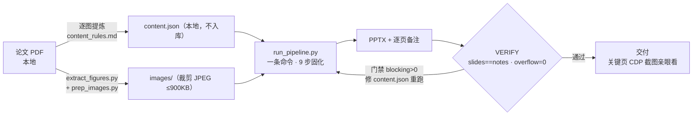

# paper-fig-deck — 文献逐图精讲 PPTX 流水线

科学论文 PDF → **逐图精讲 PPTX**：左原图 + 右大段正文（≥18pt、首行缩进 + 两端对齐）、
页底原文引用条 + 逐页演讲者备注。自学与组会汇报两用。后端 PPT 工具链**不限定**，推荐 PPT Master。

## 架构

| 项 | 说明 |
|---|---|
| 页面流 | 封面 → 中文摘要 → Introduction 五线（单页）→ 制备方法 → **论证主线总览**（有 `paper.mainline` 时，>9 项双栏）→ 逐图/表（自动拆续页）→ 中文结论 |
| 正文上限 | **实测值**（当前 14 行）；换字体/盒宽/行距跑 `measure_*` 重测，禁止凭直觉 |
| 备注模板 | 主线 / 论证 / 批判 / BMFC / 结论回响 → `pipeline/content_rules.md` |
| 9 步 | 删旧 notes → SVG → 讲稿 → 拆分 → compact → 原生表 stamp → 门禁（blocking>0 拒导出）→ 导出+后处理 → PPTX 校验+交付 |

## 安装与调用（agent）

| 步 | 内容 |
|---|---|
| ① 项目 | `git clone <本仓库>`；venv + `pip install -r requirements.txt` |
| ② 后端 | `git clone https://github.com/hugohe3/ppt-master`；设 `PPTMASTER_DIR` / `SKILL_SCRIPTS_DIR` |
| ③ 数据 | 每篇一个本地 workdir：PDF + `content.json` + 裁剪图（`extract_figures.py` / `prep_images.py` 生成） |
| ④ **一键** | `<venv-python> pipeline/run_pipeline.py <workdir> --name <交付名> [--desktop-dir <目录>]` |
| ⑤ 验收 | 看尾部 `VERIFY slides=N notes=N overflow=0`；主线总览页/长正文页用浏览器 CDP 截图亲眼看 |

- `content.json` schema + 可粘贴的 agent 启动提示词 → **`docs/agent-install.md`**
- Windows git-bash：原生路径直接传给 `python.exe`，不要 `cd` C:/… 路径

## 后端工具（不限定）

| 能力 | PPT Master（推荐）对应件 |
|---|---|
| 文本宽度估算（与门禁同模型） | `svg_to_pptx.drawingml…estimate_single_line_text_frame_width` |
| SVG→PPTX（自动换行框/逐页备注/原生图表表格） | `svg_to_pptx.py --quick-generate --with-notes --reflow-text [--native-charts-and-tables]` |
| 质量门禁（blocking/warning JSON） | `svg_quality_checker.py --json` |
| 备注拆分（与 SVG 1:1） | `total_md_split.py` |
| 原生表标记 | `stamp_native_fallbacks.py --write` |

换其他工具链：设上表两个环境变量；模块名/CLI 不同只需改 `kit.py` 头部 import 与 `run_pipeline.py`
步骤命令（共两处）。

## 版面契约（1280×720）

| 元素 | 参数 |
|---|---|
| 字体 | Times New Roman + 宋体，全部 ≥24px（18pt） |
| 左图卡 | (48,144,568,496)；图 meet 于 (64,160,536,464) |
| 右面板 | (640,144,608,496)：读点题名 → 正文（≤上限，首行缩进 48px）→ hairline y556 → 原文条 |
| 颜色 | BLUE #1F3864 · GOLD #C9A227 · DARK #333 · GRAY #595959 · LGRAY #8A8F98 |

## 目录

| 目录 | 内容 |
|---|---|
| `pipeline/` | 现行脚本：一键驱动、共享版式、门禁后处理、`content_rules.md` 方法论、`measure_*` 实测（详见 `pipeline/README.md`） |
| `pilot/` | 初代试点快照（frozen；内容数据本地不入库） |
| `docs/` | `agent-install.md` agent 安装与调用指南 |
| `<批次目录>/` | 各论文 workdir，**不入库**（`.git/info/exclude` 逐机守卫，`.gitignore` 不写批次名） |

## 版权红线

- 源 PDF / `content.json` / 裁剪图 / 交付 PPTX：**只留本地，永不提交**
- 公开仓库（含 git 历史与 LICENSE）不得出现**任何**文献信息（作者/期刊/卷期/DOI/材料名/篇内数值，
  **OA 也不行**）或任何个人信息

## 致谢（开源依赖）

PPT Master — Hugo He (hugohe3) · [MIT](https://opensource.org/licenses/MIT) ·
[github.com/hugohe3/ppt-master](https://github.com/hugohe3/ppt-master)
（本流水线复用其 SVG→PPTX 导出、质量门禁与辅助脚本；本地安装按其自身 LICENSE 使用）
